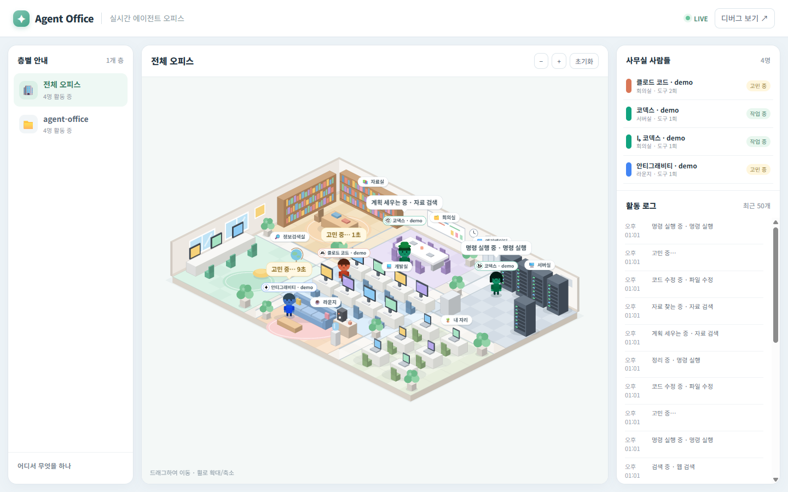
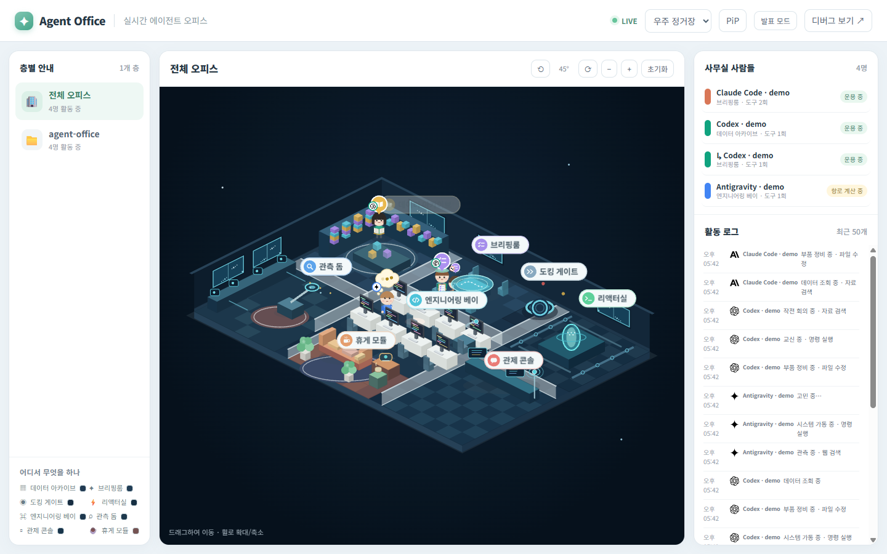
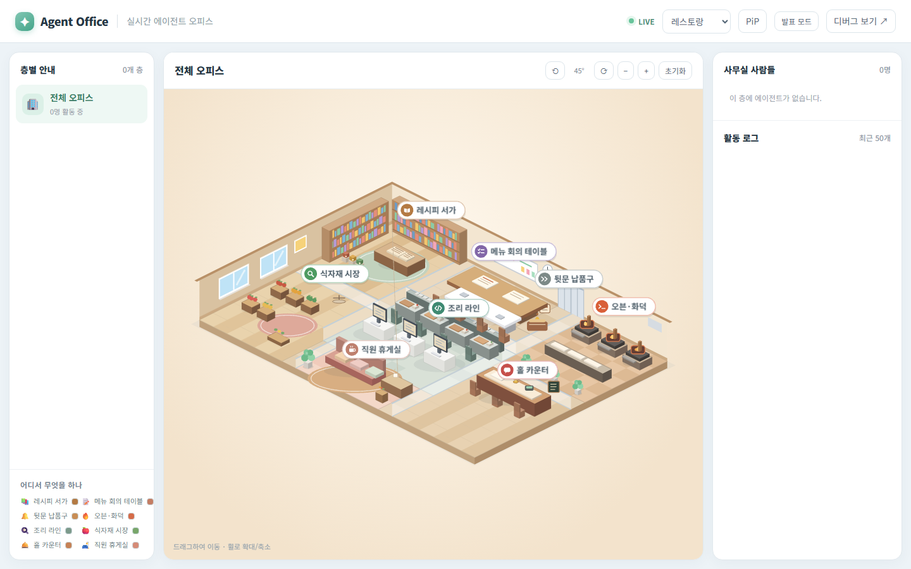
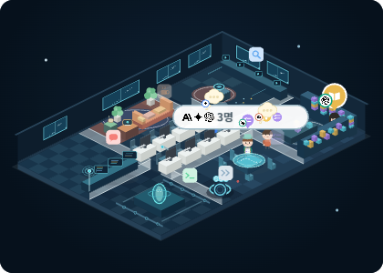

# Agent Office

Agent Office reads local AI-agent session records and turns their activity into characters moving through an isometric office. It is an unofficial, local-first dashboard for Windows.



| Space station | Restaurant | Widget |
|---|---|---|
|  |  |  |

## Run it

Windows release builds are available as an installer or portable archive on the Releases page. To run the web dashboard from source, install Node.js 24 or newer, then run:

```powershell
node --version
node server.js
Start-Process http://127.0.0.1:4777
```

No `npm install` step is needed. For demo data, use `npm run dev`; add `-- --crowd` for a busier scene.

## Supported agents and local records

| Agent | Default record location | Notes |
|---|---|---|
| Claude Code | `%USERPROFILE%\.claude\projects\<project>\*.jsonl` | Session transcripts |
| Claude Desktop | `%USERPROFILE%\.claude\projects\...` | Code-tab sessions share the Claude Code location; legacy local agent-mode records under `%APPDATA%\Claude\local-agent-mode-sessions\` are also supported |
| Codex | `%CODEX_HOME%\sessions\YYYY\MM\DD\rollout-*.jsonl` | Defaults to `%USERPROFILE%\.codex\sessions\` |
| Antigravity | `%USERPROFILE%\.gemini\antigravity\brain\<conversation>\.system_generated\logs\transcript.jsonl` | Transcript records |
| Claude Cowork inbox | `%LOCALAPPDATA%\AgentOffice\inbox\*.jsonl` | Local status reports from the optional inbox adapter |

The application formats and releases used by these integrations are not pinned. Compatibility with each agent application's current release is **unverified**; log format changes can interrupt detection.

| Component | Version status |
|---|---|
| Agent Office source in this repository | 0.4.0 |
| Node.js | 24 or newer required; tested patch version unverified |
| Claude Code | Unverified |
| Claude Desktop | Unverified |
| Claude Cowork | Unverified |
| Codex | Unverified |
| Antigravity | Unverified |

## Widget controls

The Windows widget toolbar switches between the office and mini bar, toggles click-through with the pin, opens settings, or hides the widget to the tray. The settings panel contains three themes (office, space station, restaurant), view rotation, background and overall opacity, automatic dimming, connection status, and folder selection. The main web view keeps its theme and rotation controls in the header. Press **Ctrl+Alt+O** to toggle click-through.

The mini bar is available at `http://127.0.0.1:4777/mini`. The desktop widget uses `http://127.0.0.1:4777/widget`.

## Settings

| Setting | Default | Description |
|---|---:|---|
| `port` | `4777` | Loopback server port |
| `idleAfterSec` | `60` | Delay before an agent becomes idle |
| `goneAfterSec` | `360` | Inactivity period before an agent leaves |
| `lighting` | `auto` | Automatic day/night lighting or fixed daylight |
| `presentationMode` | `false` | Hides project names and detailed labels |
| `sources.<id>.enabled` | `true` | Enables an agent source |
| `sources.<id>.path` | `null` | Adds a custom record folder for a source |

Edit `config.json` beside `server.js`; start with [`config.example.json`](config.example.json). Widget opacity settings are stored in the application settings folder and retained between launches.

## Privacy

Agent Office opens local records read-only and binds its server to `127.0.0.1`. It parses record structure locally to derive activity events and short labels; it does not retain or transmit raw prompts, tool arguments, or outputs. There is no telemetry or external service connection.

Agent log formats are undocumented and can change without notice. The application may stop recognizing sessions after an agent update. Report compatibility issues with the agent name and version; do not attach raw transcripts.

## Trademarks

Claude, Claude Code, and Anthropic are trademarks of Anthropic. Codex and OpenAI are trademarks of OpenAI. Gemini, Antigravity, and Google are trademarks of Google. Agent Office is an independent project and is not affiliated with, sponsored by, or endorsed by these companies. See the [Anthropic trademark guidance](https://www.anthropic.com/legal), [OpenAI brand guidelines](https://openai.com/brand/), and [Google brand guidance](https://about.google/brand-resource-center/guidance/).

---

# Agent Office (한국어)

Agent Office는 PC에 저장된 AI 에이전트 세션 기록을 읽어, 아이소메트릭 오피스 안에서 움직이는 캐릭터로 보여 주는 로컬 대시보드입니다. Windows용 비공식 도구입니다.


| 우주 정거장 | 레스토랑 | 위젯 |
|---|---|---|
|  |  |  |

## 실행

Windows 릴리스에서 설치 파일이나 포터블 압축 파일을 받을 수 있습니다. 소스에서 웹 화면을 실행하려면 Node.js 24 이상을 설치한 뒤 다음 명령을 실행하세요.

```powershell
node --version
node server.js
Start-Process http://127.0.0.1:4777
```

`npm install`은 필요하지 않습니다. 데모 데이터는 `npm run dev`, 캐릭터를 많이 보려면 `npm run dev -- --crowd`로 실행합니다.

## 지원 에이전트와 기록 위치

| 에이전트 | 기본 기록 위치 | 설명 |
|---|---|---|
| Claude Code | `%USERPROFILE%\.claude\projects\<프로젝트>\*.jsonl` | 세션 기록 |
| Claude Desktop | `%USERPROFILE%\.claude\projects\...` | Code 탭 기록은 Claude Code와 공유. 예전 에이전트 모드 기록 `%APPDATA%\Claude\local-agent-mode-sessions\`도 지원 |
| Codex | `%CODEX_HOME%\sessions\YYYY\MM\DD\rollout-*.jsonl` | 기본 위치 `%USERPROFILE%\.codex\sessions\` |
| Antigravity | `%USERPROFILE%\.gemini\antigravity\brain\<대화ID>\.system_generated\logs\transcript.jsonl` | 대화 기록 |
| Claude Cowork 인박스 | `%LOCALAPPDATA%\AgentOffice\inbox\*.jsonl` | 선택 기능인 로컬 상태 보고 인박스 |

각 에이전트 앱의 호환 버전은 고정하지 않았습니다. 현재 앱 버전과의 호환성은 **미확인**이며 로그 형식이 바뀌면 감지가 중단될 수 있습니다.

| 구성 요소 | 버전 상태 |
|---|---|
| 이 저장소의 Agent Office 소스 | 0.4.0 |
| Node.js | 24 이상 필요, 검증한 세부 버전은 미확인 |
| Claude Code | 미확인 |
| Claude Desktop | 미확인 |
| Claude Cowork | 미확인 |
| Codex | 미확인 |
| Antigravity | 미확인 |

## 위젯 조작

Windows 위젯 도구막대에서 오피스·미니 바를 바꾸고, 핀으로 클릭 통과를 켜고 끄며, 설정을 열거나 위젯을 트레이로 숨길 수 있습니다. 설정 패널에서 오피스·우주 정거장·레스토랑 테마, 시점 회전, 배경·전체 투명도, 자동 흐림, 연결 상태와 폴더 연결을 관리합니다. 본 화면의 테마·회전 조작은 헤더에 남아 있습니다. **Ctrl+Alt+O**로 클릭 통과를 전환합니다.

미니 바 주소는 `http://127.0.0.1:4777/mini`, 데스크톱 위젯 주소는 `http://127.0.0.1:4777/widget`입니다.

## 설정

| 항목 | 기본값 | 설명 |
|---|---:|---|
| `port` | `4777` | 루프백 서버 포트 |
| `idleAfterSec` | `60` | 유휴 상태로 바뀌기까지의 시간 |
| `goneAfterSec` | `360` | 퇴근 전 대기 시간 |
| `lighting` | `auto` | 자동 낮·밤 조명 또는 낮 고정 |
| `presentationMode` | `false` | 프로젝트 이름과 자세한 라벨 숨김 |
| `sources.<id>.enabled` | `true` | 에이전트 기록 감시 여부 |
| `sources.<id>.path` | `null` | 출처에 추가할 기록 폴더 |

`server.js` 옆의 `config.json`을 수정하세요. 시작 설정은 [`config.example.json`](config.example.json)을 참고하면 됩니다. 위젯 투명도는 앱 설정 폴더에 저장되어 다음 실행에도 유지됩니다.

## 개인정보

Agent Office는 로컬 기록을 읽기 전용으로 열고 서버를 `127.0.0.1`에만 바인딩합니다. 기록 구조를 로컬에서 해석해 활동과 짧은 라벨을 만들며 프롬프트, 도구 인수, 출력 원문을 보관하거나 전송하지 않습니다. 텔레메트리와 외부 서비스 연결은 없습니다.

에이전트 로그 형식은 공개 규격이 아니며 예고 없이 바뀔 수 있습니다. 앱 업데이트 뒤 세션 감지가 멈출 수 있습니다. 호환성 문제를 제보할 때는 에이전트 이름과 버전만 보내고 원본 기록은 첨부하지 마세요.

## 상표

Claude, Claude Code, Anthropic은 Anthropic의 상표입니다. Codex와 OpenAI는 OpenAI의 상표입니다. Gemini, Antigravity, Google은 Google의 상표입니다. Agent Office는 독립 프로젝트이며 해당 회사와 제휴·후원·보증 관계가 없습니다. [Anthropic 상표 안내](https://www.anthropic.com/legal), [OpenAI 브랜드 지침](https://openai.com/brand/), [Google 브랜드 안내](https://about.google/brand-resource-center/guidance/)를 참고하세요.
